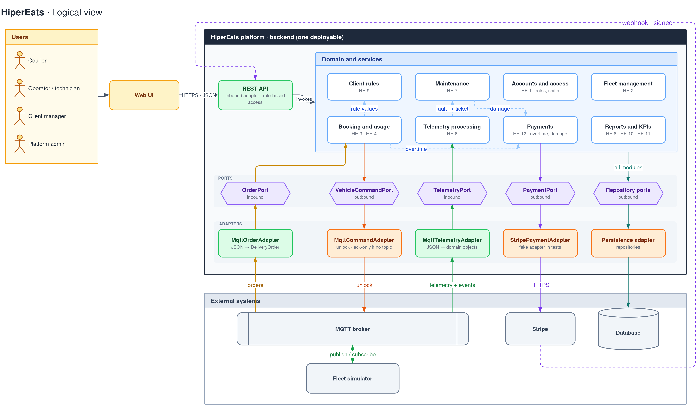
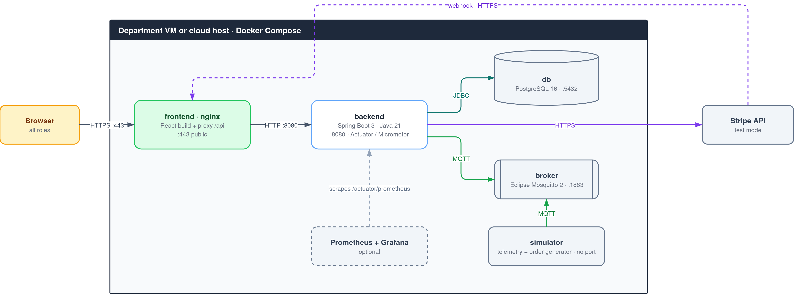

# HiperEats

<!-- CI and SonarCloud badges go here once the pipeline is in place -->

## Project abstract

**HiperEats** is a managed e-scooter fleet-as-a-service for food delivery from hypermarket food courts.

HiperEats owns a fleet of electric scooters and supplies it as a managed service to a (fictional) hypermarket chain with restaurants and take-away counters. Couriers book a scooter at their store's hub, deliver meals to nearby customers and return it to the hub. HiperEats manages the vehicle lifecycle and handles maintenance within the agreed SLA. The hypermarket chain, as the institutional client, sets the rules of use and follows usage reports and business and technical KPIs.

Vehicle state is driven by telemetry from a separate fleet simulator (battery, position, lock state, faults), and payments go through Stripe in test mode.

This is the group project of the Software Testing and Quality (TQS) course, University of Aveiro, 2026/27.

## Project team

| Name | Student no. | Role |
|---|---|---|
| André Martins | 119136| QA Engineer, DevOpsMaster |
| Daniel Rodrigues | 125414 | Team Coordinator |
| Martim Travesso | 125925 | Product Owner |

Every member is also a developer.

## Project bookmarks

| Resource | Link |
|---|---|
| Jira backlog | [HiperEats backlog](https://hipereats.atlassian.net/jira/software/projects/HE/boards/2/backlog) |
| API documentation (Swagger UI) | _TBD_ |
| Static analysis dashboard | _TBD_ |
| Observability dashboard | _TBD_ |
| Deployed application | _TBD_ |

## Architecture

The backend is one deployable built with ports and adapters: the domain and services never call the fleet simulator, Stripe or the database directly, only through their ports.

**Logical view:** modules, ports and adapters, and the external systems they reach.



**Deployment view:** the containers run with Docker Compose on one host.



## Repository structure

```
backend/      Spring Boot (Java 21) platform
frontend/     web UI (React)
simulator/    fleet telemetry simulator (own container)
docs/         Product Specification report, QA Manual, presentation (PDF), architecture diagrams
.github/      CI workflows, pull request template, Dependabot
AGENTS.md     instructions for AI agents
CONTRIBUTING.md  code style, workflow and review checklist
```
